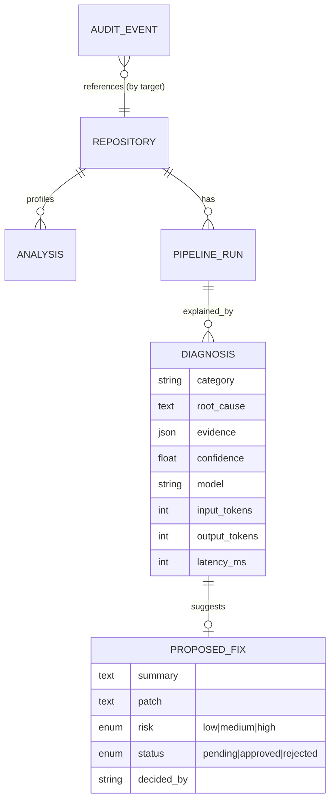
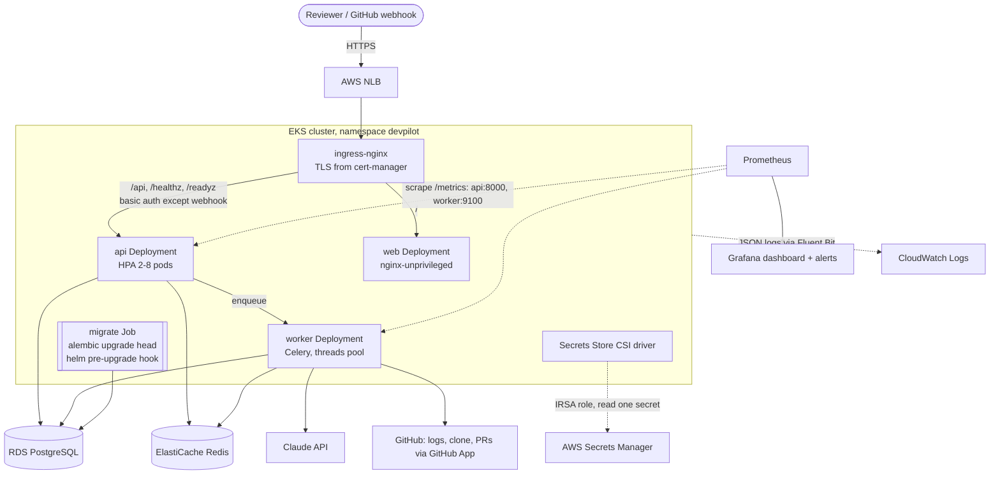
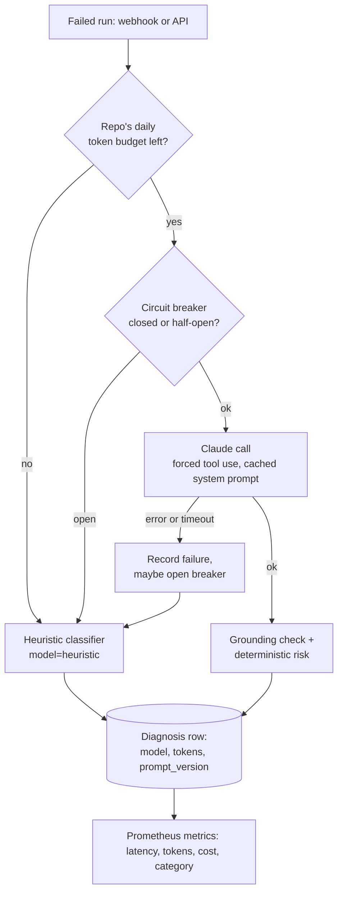
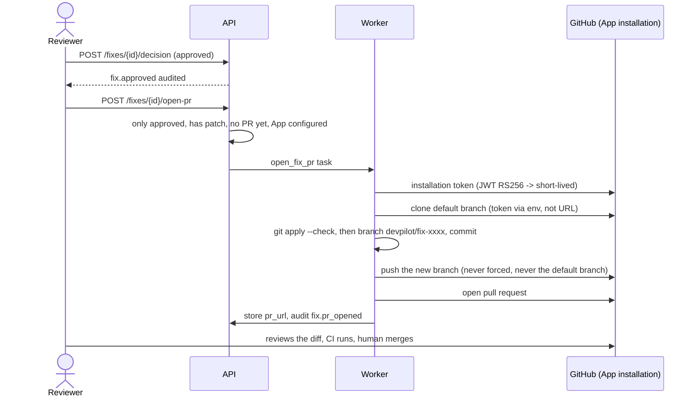

# DevPilot AI — Architecture

## 1. Purpose and scope

DevPilot AI connects to a GitHub repository, profiles it, and — as its **core feature** — diagnoses
failed CI/CD runs with Claude, proposing evidence-backed fixes that a human must approve before
anything changes. Every other capability (repository intelligence, deployment assistant,
observability) supports that single workflow.

**Core workflow**

```
GitHub Actions run fails
  -> DevPilot fetches failed job logs
  -> redacts secrets, trims to the failure window, classifies heuristically
  -> Claude returns a structured diagnosis (category, root cause, evidence, fix, patch)
  -> evidence is verified against the log; risk is assigned by deterministic rules
  -> human reviews in the dashboard and approves / rejects
  -> (Phase 3) approved fix is opened as a pull request on a new branch - never pushed to main
  -> every step is written to the audit trail
```

## 2. System context


## 3. Components

| Component | Technology | Responsibility | Phase |
|---|---|---|---|
| Web dashboard | React 18, TypeScript, Vite, Nginx | Connect repos, paste/view diagnoses, approve fixes, audit trail | 1 |
| API | Python 3.12, FastAPI, Pydantic v2 | REST endpoints, validation, approval gate, health probes | 1 |
| Workers | Celery + Redis | Clone/scan repos, fetch logs, call Claude, run checks — anything slow | 1 |
| Repo analyzer | Pure Python | Deterministic detection: languages, frameworks, manifests, CI, Docker, K8s, risk flags | 1 |
| Log processor | Pure Python (regex) | Secret redaction, failure-window extraction, heuristic classification | 1 |
| Diagnoser | Claude API (forced tool use) | Structured diagnosis; evidence verification; deterministic risk scoring | 1 |
| Persistence | PostgreSQL 16, SQLAlchemy 2 (Alembic in Phase 2) | Entities + append-only audit events | 1 |
| Check runner | Docker sandbox (ruff, pytest, eslint, pip-audit, Trivy) | Re-run checks on a cloned repo in an isolated container | 2 |
| GitHub integration | GitHub App or fine-grained PAT, webhooks | Receive `workflow_run` events; open PRs for approved fixes | 2–3 |
| Deployment assistant | Claude + kubeconform/hadolint | Generate Dockerfiles/manifests, validate before suggesting | 3 |
| Platform | Docker Compose → Linux VM → Kubernetes (AKS/EKS) via Helm | Runtime environments | 2–3 |
| Observability | structlog JSON, Prometheus metrics, cloud monitoring | Latency, token cost, failure rates, AI usage | 3 |

## 4. Repository layout

```
devpilot-ai/
├── backend/
│   ├── app/
│   │   ├── api/routes/        health, repositories, diagnoses (+ approval gate, audit)
│   │   ├── core/              config (env-driven), db, structured logging
│   │   ├── models/            SQLAlchemy entities
│   │   ├── schemas/           Pydantic request/response models
│   │   ├── services/          repo_analyzer, log_processing, claude_client, diagnoser,
│   │   │                      github_client, audit
│   │   └── workers/           Celery app + tasks
│   ├── tests/                 pytest (FakeClaude - no API key needed in CI)
│   ├── Dockerfile             multi-stage, non-root, healthcheck
│   └── pyproject.toml
├── frontend/                  React + TS dashboard (Diagnose, Repositories, Audit)
├── evals/                     labelled failure cases + evaluation harness
├── infra/
│   ├── k8s/base/              Plain manifests (kustomize), kept as a reference
│   ├── helm/devpilot/         Helm chart: values-dev/prod, ingress+TLS, HPA, CSI secrets, dashboard
│   ├── terraform/             ECR + ECS Fargate (cheap demo) and the GitHub OIDC publish role
│   └── terraform-eks/         VPC, EKS, RDS, ElastiCache, Secrets Manager, IRSA
├── deploy/vm/                 Production compose, Caddyfile, systemd unit, logrotate (Phase 2)
├── scripts/                   dev.sh, deploy.sh, db-backup.sh, vm-bootstrap.sh, eks-addons.sh, ...
├── docs/                      ARCHITECTURE, ROADMAP, SAFETY, ADRs
├── .github/workflows/ci.yml   lint, test, audit, build, scan, manifest validation
└── docker-compose.yml         postgres, redis, api, worker, web
```

## 5. Data model



## 6. AI design (how Claude is used responsibly)

1. **Deterministic first.** Language/framework detection, secret redaction, log trimming and risk
   scoring are code, not prompts. Claude receives a compact profile and a trimmed log — never
   the whole repository.
2. **Structured outputs.** The diagnosis is obtained by forcing a tool call with a JSON schema,
   so responses are machine-validated rather than parsed from prose.
3. **Grounding check.** Each evidence line Claude cites must exist verbatim in the log; otherwise
   it is dropped and confidence is capped. This is the main hallucination control.
4. **Risk is not the model's decision.** Files touched → low / medium / high via fixed rules.
   High-risk approvals require a written justification.
5. **Graceful degradation.** If the API key is missing, the API times out or retries are
   exhausted, the heuristic classifier still returns a result labelled `model=heuristic`.
6. **Measured.** Every call logs model, tokens and latency; `evals/` tracks category accuracy
   and keyword recall so prompt changes are regression-tested.

## 7. Security model (summary; full STRIDE threat model in [SAFETY.md](SAFETY.md))

| Threat | Control |
|---|---|
| Secrets in CI logs sent to a third-party LLM | Regex redaction before any LLM call; data minimisation |
| Prompt injection inside logs or repo files | Logs treated as data; model cannot act — only propose; schema-constrained output; human approval |
| Malicious code executed during checks | Checks run in throwaway containers, non-root, no secrets mounted, CPU/memory/time limits |
| Over-privileged GitHub access | Fine-grained token: read-only Actions + Contents in Phase 1; PR-write only in Phase 3 |
| Unreviewed changes reaching production | Approval gate + PRs only on new branches; no direct pushes |
| Repudiation | Append-only `audit_events` for connect, analyse, diagnose, approve, reject |
| Container breakout / lateral movement | `runAsNonRoot`, `readOnlyRootFilesystem`, `allowPrivilegeEscalation: false`, resource limits |

## 8. Deployment topology

| Stage | Environment | Notes |
|---|---|---|
| Local | `docker compose up` | All five services; SQLite only for unit tests |
| Cheap demo | ECS Fargate + ECR (`infra/terraform`) | One task with Postgres/Redis as containers; data is ephemeral. See [DEPLOY-AWS.md](DEPLOY-AWS.md) |
| Phase 2 | One Linux VM (Ubuntu) | Docker Compose, Caddy TLS, ufw, systemd, nightly backups. See [DEPLOY-VM.md](DEPLOY-VM.md) |
| Phase 3 | **EKS** + RDS + ElastiCache (`infra/terraform-eks`, `infra/helm`) | Helm chart, Secrets Manager via CSI, ingress + cert-manager TLS, HPA, Prometheus/Grafana, CloudWatch. See [DEPLOY-K8S.md](DEPLOY-K8S.md) |

### 8.1 Kubernetes layout (Phase 3)



## 9. Reliability of the AI path (Phase 3)



- **Per-repo daily token budget** (`DEVPILOT_REPO_DAILY_TOKEN_BUDGET`, summed from stored
  diagnoses for the UTC day) stops one noisy repository from burning the whole spend.
- **Circuit breaker** (`DEVPILOT_LLM_BREAKER_*`): after N consecutive failures Claude calls are
  rejected immediately for a cooldown, then one trial call decides whether to close it.
- **Prompt caching:** the system prompt is marked `cache_control: ephemeral`. It only takes
  effect once the cached prefix is long enough for the model's minimum, so today's short prompt
  mostly will not cache; the cache-read token count is recorded so you can see when it does.
- **Prompt version** (`diagnose-v1`) is stored on every diagnosis so a quality change can be tied
  to the prompt that produced it. Bump it whenever the prompt or schema changes.
- **Evals:** `evals/run_evals.py` runs on every PR (heuristic and FakeClaude modes, with a baseline
  gate) and nightly against real Claude with a spend cap.

## 10. From approved fix to pull request (Phase 3)



The App holds only Contents: write and Pull requests: write. DevPilot never merges.

## 11. Observability (Phase 3)

| Signal | Source | Where it shows up |
|---|---|---|
| Diagnosis latency, tokens, estimated cost, failure categories, approval rate | `/metrics` (API) and worker port 9100 | Grafana dashboard `DevPilot AI` (shipped in the chart) |
| Breaker state, Claude errors, fallback share, budget degradations | same | Dashboard + Prometheus alerts (`PrometheusRule`) |
| API request latency and 5xx by route | `devpilot_http_request_duration_seconds` | Dashboard + alert |
| Structured JSON logs | structlog to stdout | CloudWatch Logs through the EKS Container Insights addon |
| Who did what | `audit_events` table, `/api/audit` | Dashboard Audit page |
