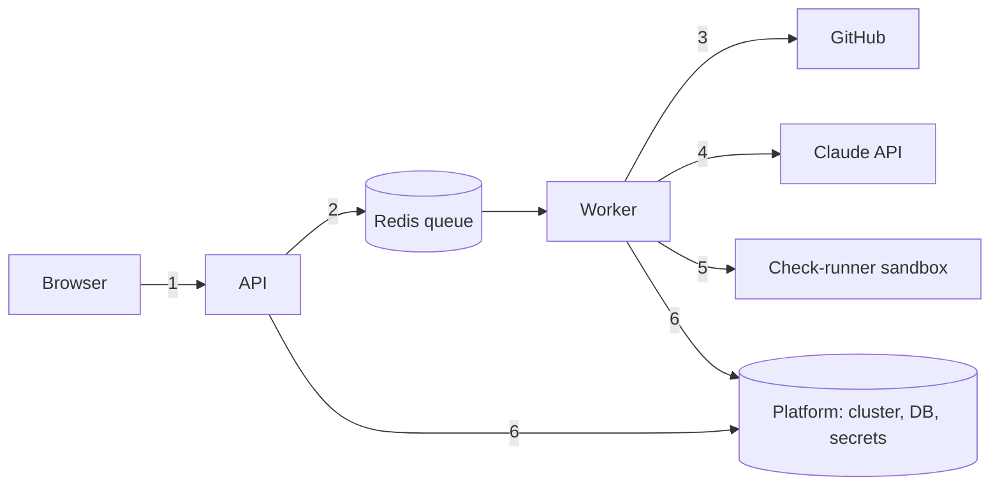

# Safety and Threat Model

Scope: DevPilot AI reads CI logs and repositories, sends redacted excerpts to Claude, and can open
pull requests for fixes a human approved. The worst outcomes are (1) leaking secrets or source to
a third party, (2) an unreviewed or malicious change reaching a repository, (3) running untrusted
code on our infrastructure, and (4) runaway cost.

Method: STRIDE per trust boundary. **Status** is one of: `Done` (implemented and tested),
`Partial` (a control exists but has a stated limit), `Gap` (not implemented; tracked below).
The last column names the test or file that proves the control, so it can be checked.

## 1. Browser to API

| STRIDE | Threat | Control | Status | Evidence |
|---|---|---|---|---|
| Spoofing | Anyone who can reach the URL acts as a reviewer | GitHub OAuth sign-in (signed HttpOnly session cookie, optional allow-list); basic auth at the proxy as an alternative. Webhook and health paths are public by design | Done when OAuth is configured; open in local mode | `test_auth.py`, docs/AUTH.md |
| Tampering | Malformed or hostile input | Pydantic validation (repo name pattern, enums, size limits); ORM with bound parameters, no raw SQL | Done | `test_api.py::test_connect_repository` (422 on bad input) |
| Repudiation | A reviewer denies an approval | Append-only `audit_events`; with sign-in on the reviewer is the session's GitHub login, never a client-supplied name | Done when OAuth is configured | `test_api.py::test_high_risk_fix_requires_justification` |
| Info disclosure | Metrics or internals exposed | `/metrics` is not routed by ingress or Caddy; only in-cluster scraping | Done | `templates/ingress.yaml`, `Caddyfile` (path allow-list) |
| Denial of service | Request flood or expensive calls | Body-size limit at ingress; Claude input trimmed to `max_log_chars` | Partial: no per-client rate limiting, and `/api/diagnose-log` is not covered by the per-repo token budget | Gap G1 |
| Elevation | CSRF | `SameSite=Lax` session cookie, OAuth `state` check, and a required `X-Requested-With: devpilot` header on writes (a cross-site form cannot set it) | Done | `test_auth.py::test_writes_need_the_csrf_header`, `::test_callback_rejects_missing_or_tampered_state` |

## 2. API to workers (queue)

| STRIDE | Threat | Control | Status | Evidence |
|---|---|---|---|---|
| Spoofing / Tampering | Forged task messages in Redis run arbitrary work | Tasks take only row IDs and load everything from the DB; no code or commands travel in messages. Redis reachable only from cluster nodes (security group) | Partial: Redis has no AUTH or TLS | `tasks.py`; `terraform-eks/data.tf` SG. Gap G2 |
| Repudiation | Work happens with no record | Each task writes an audit event (success and failure) | Done | `test_webhooks.py::test_diagnosis_task_records_failure_when_github_fails` |
| Denial of service | Stuck or runaway task | `task_time_limit` 600 s, `acks_late`, prefetch 1, per-pod resource limits | Done | `celery_app.py`, chart `worker.yaml` |
| Info disclosure | Logs leak payloads | structlog events carry IDs, counts and error classes, not log bodies | Partial | review `app/core/logging.py` usage |

## 3. Workers to GitHub (and the webhook in)

| STRIDE | Threat | Control | Status | Evidence |
|---|---|---|---|---|
| Spoofing | Fake webhook triggers diagnoses | HMAC-SHA256 on the raw body, constant-time compare; 503 if no secret is set (never open) | Done | `test_webhooks.py::test_verify_signature`, `::test_rejects_bad_signature`, `::test_disabled_without_secret` |
| Tampering | Replayed or duplicated deliveries | Idempotent per run id | Done | `::test_failed_run_queues_diagnosis_once` |
| Info disclosure | Token theft widens blast radius | Read-only fine-grained token for logs; the PR path uses a GitHub App with only Contents: write and Pull requests: write, short-lived installation tokens passed to git through the environment (never in a URL), scrubbed from errors | Done | `github_app.py`; `test_pull_request.py` |
| Tampering | An AI patch lands without review | Approval gate; PRs only for approved fixes, on a new `devpilot/fix-*` branch, never forced, never the default branch; patch must pass `git apply --check`; DevPilot never merges | Done | `test_pull_request.py::test_opens_pr_from_new_branch_and_never_touches_main`, `::test_bad_patch_is_rejected_before_anything_is_pushed`, `::test_open_pr_endpoint_guards` |
| Elevation | Patch edits CI to exfiltrate secrets | Edits to workflows, Dockerfiles or infra score `high` risk by fixed rules and need a written justification; the App has no `workflows` permission, so GitHub refuses workflow-file pushes | Done | `test_diagnoser.py`, `evals` guardrail "workflow edits are high risk" |
| Repudiation | Who approved the PR? | `fix.approved`, `fix.pr_requested`, `fix.pr_opened` / `fix.pr_failed` audit events; reviewer note in the PR body | Partial: reviewer identity is self-declared until 1.15 | `test_pull_request.py::test_open_pr_endpoint_guards` |

## 4. Workers to Claude API

| STRIDE | Threat | Control | Status | Evidence |
|---|---|---|---|---|
| Info disclosure | Secrets or source sent to a third party | Regex redaction before any LLM call; only a trimmed failure window and a small profile are sent, never the repo | Partial: regex redaction cannot catch every secret format | `test_log_processing.py`; evals "secrets are redacted" |
| Tampering | Prompt injection in logs or repo files ("ignore previous instructions") | Logs are data, not instructions. The model cannot act: output is a forced tool call with a JSON schema, and a human must approve. Risk is decided by rules, not by the model | Done (reduces, does not eliminate) | `diagnoser.py`; evals guardrail checks |
| Tampering | Hallucinated evidence or fixes | Each cited evidence line must appear verbatim in the log or it is dropped and confidence capped at 0.3 | Done | `test_diagnoser.py::test_rejects_hallucinated_evidence`, `::test_caps_confidence_without_evidence` |
| Denial of service / cost | Runaway spend or retries against a failing API | Per-repo daily token budget; circuit breaker with half-open trial; bounded retries and timeouts; automatic fallback to the offline classifier | Done | `test_reliability.py` (breaker, budget, fallback); dashboard and alerts |
| Repudiation | Which prompt produced this answer? | `prompt_version` stored on every diagnosis, plus model and token counts | Done | `test_reliability.py::test_prompt_version_recorded_on_result` |
| Spoofing | Calls with a stolen API key | Key only in Secrets Manager, mounted through CSI; never in the chart, git or images | Done | `templates/secretproviderclass.yaml` |

## 5. Workers to check-runner sandbox (untrusted code)

| STRIDE | Threat | Control | Status | Evidence |
|---|---|---|---|---|
| Elevation | Repo code escapes the container or takes the host | Throwaway container: non-root, read-only root fs, `cap_drop=ALL`, `no-new-privileges`, pid/memory/CPU limits, hard timeout then kill and remove, read-only mount of the clone, tmpfs working copy | Partial: the check-worker holds the Docker socket, which is root-equivalent on that host | `test_check_runner.py` asserts the flags on every container. Gap G3 |
| Info disclosure | Repo code reads our secrets | The sandbox gets no environment secrets and no DB or Redis access | Done | `check_runner.py` (only `SRC`, `HOME`, `CI`) |
| Denial of service | Fork bomb, memory hog, infinite loop | pids, memory, CPU limits; timeout | Done | `test_check_runner.py::test_timeout_kills_and_removes_container` |
| Info disclosure | Code exfiltrates over the network | Egress is allowed because dependency installs need it (`DEVPILOT_RUNNER_NETWORK=none` for offline-only) | Partial | Gap G3 |
| Isolation | Check runs on ECS Fargate or the main worker | The check-worker is opt-in, on its own queue, and unavailable on Fargate | Done | `docker-compose.yml` profile `checks` |

## 6. Platform (cluster, database, secrets, supply chain)

| STRIDE | Threat | Control | Status | Evidence |
|---|---|---|---|---|
| Info disclosure | Secrets in git, images or Helm values | AWS Secrets Manager read by the Secrets Store CSI driver through an IRSA role scoped to one secret; no plain Kubernetes Secret is authored by us (the driver syncs one at runtime) | Done | `secretproviderclass.yaml`, `terraform-eks/secrets.tf` |
| Elevation | Container breakout or lateral movement | `runAsNonRoot`, read-only root fs, drop ALL capabilities, no privilege escalation, seccomp `RuntimeDefault`, NetworkPolicy allowing only ingress-nginx, Prometheus and the release itself | Done | chart templates; kubeconform in CI |
| Tampering | Vulnerable or tampered images | Trivy fails CI on fixable CRITICAL (api, web); pinned base images and validator binaries; images pushed to ECR with scan-on-push; GitHub OIDC with no long-lived AWS keys, trusting only `main` and `v*` tags | Done | `ci.yml`, `terraform/cicd.tf` |
| Info disclosure | Database exposed | RDS and ElastiCache in private subnets, reachable only from the node security group; RDS encrypted at rest | Done | `terraform-eks/data.tf` |
| Denial of service | Pod or node loss | HPA on the API, PodDisruptionBudget, topology spread, Multi-AZ RDS in prod | Done | chart `api.yaml`, `terraform-eks/data.tf` |
| Repudiation | Cluster changes with no trail | App and node logs to CloudWatch via the Container Insights addon; control-plane audit/api/authenticator logs are on by default in the EKS module (confirm with `aws eks describe-cluster --query cluster.logging`) | Done, to be verified after the first apply | `terraform-eks/eks.tf` |
| Tampering | Schema drift or racing migrations | A Helm pre-upgrade Job runs `alembic upgrade head`; API replicas never migrate (`DEVPILOT_AUTO_MIGRATE=false`) | Done | `templates/migrate-job.yaml`, `test_migrations.py` |

## Known gaps (tracked)

| ID | Gap | Planned mitigation |
|---|---|---|
| G1 | No per-client rate limiting; `/api/diagnose-log` bypasses the per-repo token budget | Add rate limiting at the ingress and a global daily budget for ad-hoc diagnoses |
| G2 | Redis has no AUTH and no TLS | Enable in-transit encryption plus an auth token and use `rediss://` |
| G3 | Check-worker holds the Docker socket; sandbox has outbound network | Rootless Docker or gVisor/Firecracker, a docker-socket proxy, and an egress allow-list |
| G4 | Authentication is optional and there is one shared workspace: no per-user or per-organisation access control | Make sign-in mandatory outside local mode, then scope repositories to their connecting user or organisation |
| G5 | Redaction is regex-based | Add entropy-based detection and a secrets scanner pass before LLM calls |

## AI-specific risk notes

- **Over-reliance:** every fix is a proposal. The UI and PR text say so, confidence is capped when
  evidence cannot be verified, and approval requires a human. Treat 0.3-confidence heuristic
  results as hints only.
- **Model quality drift:** evals run on every PR (offline) and nightly against real Claude with a
  baseline gate; `prompt_version` links a regression to its prompt.
- **Data handling:** only redacted, trimmed log windows leave the system, and clones are deleted
  after use. Check the Anthropic data-retention terms that apply to your account before using
  private repositories.

---

## Phase 2 controls (detail)

### Webhook (`POST /api/webhooks/github`)
- The raw body is verified against `X-Hub-Signature-256` before it is parsed. With no
  `DEVPILOT_GITHUB_WEBHOOK_SECRET` the endpoint returns 503, so it can never run unauthenticated.
- Only completed, failed `workflow_run` events for already connected repositories are acted on,
  and deliveries are idempotent per run id.

### Check runner
Each check runs in its own throwaway container (see section 5). The `check-worker` is a separate,
opt-in service that only consumes the `checks` queue. Do not enable it on a shared or public host
without a socket proxy or rootless Docker/gVisor.

### Exposure on the VM
Caddy puts HTTP basic auth in front of the dashboard and API. Only the webhook and health probes
are public. This is a stopgap until real authentication (roadmap 1.15).
